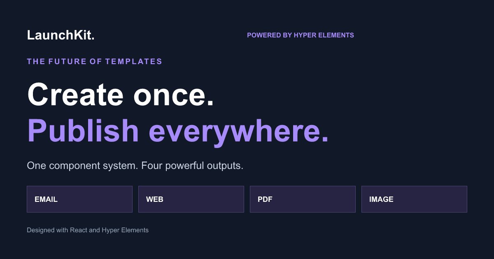

# LaunchKit

## One design. Four possibilities.

LaunchKit is an open-source multi-format template studio built with React and [Hyper Elements](https://hyper-elements.dev/). It demonstrates how one shared design system can produce four real creative outputs:

- **Website** — a product landing page rendered to HTML
- **Email** — a responsive welcome email rendered to HTML and plain text
- **PDF** — a professional, print-ready invoice
- **Social** — a 1200 × 630 PNG announcement graphic

The project is designed for the [Hyper Elements Template Challenge](https://hyper-elements.dev/) and keeps the source in JavaScript/JSX.

## Preview

The Vite app includes a responsive studio interface with searchable template cards, category filters, output previews and direct links to generated artifacts.

### Website studio


### Welcome email


### Social output



Generated outputs are written to:

```text
launchkit-preview.html
welcome-email.html
welcome-email.txt
out/launchkit-invoice.pdf
out/launchkit-social.png
```

## Features

- Shared LaunchKit theme tokens across all four Hyper Elements templates
- Responsive SaaS-style template gallery
- Working category filters and template search
- Accessible navigation, buttons, links and preview modal
- Deterministic HTML, PDF and PNG render scripts
- Cross-platform social image font lookup with environment variable overrides
- React JSX only — no TypeScript or TSX

## Tech stack

React · JavaScript/JSX · Vite · Hyper Elements · Node.js · Lucide React

## Getting started

```bash
git clone https://github.com/santanu-atta03/launchkit-hyper-elements.git
cd launchkit-hyper-elements
npm install
npm run dev
```

Open the local URL printed by Vite.

## Commands

| Command | Purpose |
| --- | --- |
| `npm run dev` | Start the development server |
| `npm run build` | Create the production web build |
| `npm run lint` | Run ESLint |
| `npm run preview` | Preview the production build |
| `npm run render:page` | Generate `launchkit-preview.html` |
| `npm run render:email` | Generate HTML and plain-text email files |
| `npm run render:invoice` | Generate `out/launchkit-invoice.pdf` |
| `npm run render:social` | Generate `out/launchkit-social.png` |
| `npm run render:all` | Run all four renderers |

The social renderer looks for DejaVu Sans on Linux and Arial on Windows. To use custom fonts, set `LAUNCHKIT_FONT_REGULAR` and `LAUNCHKIT_FONT_BOLD` to font file paths before running `npm run render:social`.

## Project structure

```text
src/
├── App.jsx                    # Interactive studio interface
├── App.css                    # Product UI and responsive styles
├── index.css                  # Global CSS tokens and reset
├── templates/
│   ├── LaunchKitPage.jsx      # Hyper Elements Page → HTML
│   ├── WelcomeEmail.jsx       # Hyper Elements Email → HTML/text
│   ├── Invoice.jsx            # Hyper Elements Document → PDF
│   └── SocialCard.jsx         # Hyper Elements Canvas → PNG
└── theme/
    └── launchkitTheme.js      # Shared Hyper Elements theme
scripts/
├── render-page.jsx
├── render-email.jsx
├── render-invoice.jsx
└── render-social.jsx
```

## Architecture

The interactive site is ordinary React and CSS so it can provide meaningful search, filtering, previews and responsive navigation. The four generated outputs remain native Hyper Elements templates:

1. `Page` renders the web landing page.
2. `Email` renders HTML and plain text email output.
3. `Document` renders the invoice to PDF.
4. `Canvas` renders the social graphic to PNG.

All four templates import `src/theme/launchkitTheme.js`, while format-specific layout decisions remain inside each template. Hyper Elements validation runs as part of rendering and rejects unsupported structures or styles.

## Contributing

1. Fork the repository and create a focused branch.
2. Keep generated templates in JSX and use the installed Hyper Elements API.
3. Run `npm run lint`, `npm run build` and `npm run render:all`.
4. Include a clear description and screenshots for visual changes.

## License

MIT © LaunchKit contributors